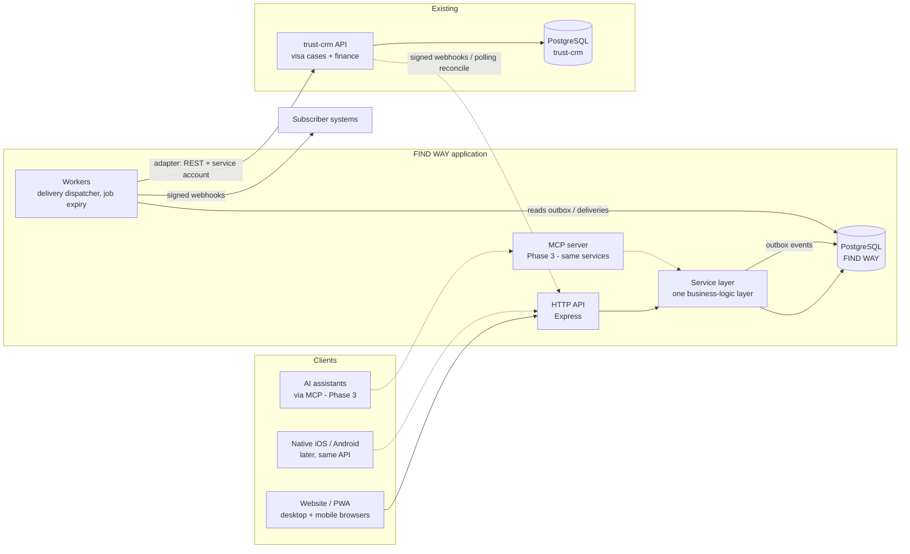

# FIND WAY — Architecture and integration plan (Phase 0)

Status legend used across these docs: **Implemented** (code exists) · **Tested** (automated test proves it) · **Deferred** (designed, not built) · **Blocked** (needs access/credentials/decisions from the owner).
The per-requirement ledger is [STATUS.md](STATUS.md). What I need from you is [INTEGRATION_CHECKLIST.md](INTEGRATION_CHECKLIST.md).

## 1. What was inspected

Only one codebase was available: this repository (`emnaservicesgroupe/emna`).

| Area | Finding |
|---|---|
| Repository | `trust-crm/` — one Express 4 + PostgreSQL (`pg`) app, ~1,200 lines, 4 small test files. `Makefile` runs them. `.github/workflows/deno.yml` is an unrelated template. No other services, no front-end, no deployment configuration beyond a `Dockerfile` (`node:18`, root user). |
| What it is | A **visa-case tracking CRM**: staff users (7 roles), `candidates` keyed by **passport number** (`NOT NULL UNIQUE`), one `visa_applications` row per candidate, document *metadata* (a `file_path` string, no storage), invoices/payments/expenses, expiry alerts (node-cron), `audit_logs`. |
| Identifiers | Integer `SERIAL` ids everywhere. |
| Auth | Email+password, bcrypt, JWT (7 days) with `{id, role}`. No organisations, no external (candidate/employer/agency) accounts, no OTP/MFA, no refresh/revocation. |
| Authorisation | Role → permission map in `middleware/role.js`; **no record-level scoping** (any user with `candidates:write` can edit any candidate). `sql/rls_policies.sql` targets Supabase (`auth.jwt()`); see SECURITY_FINDINGS. |
| Not present | Jobs, employers/companies as entities, leads, applications, interviews, messaging, multi-language, public site, webhooks, API docs, migrations tooling, file storage, e-mail provider wiring (nodemailer is a dependency but unused for sending). |
| Not available to me | The live CRM URL, the "platform" you mention, any other repository, production data, credentials, deployment access, API docs, webhooks, auth provider, storage/communication providers. Everything below that touches these is designed against `trust-crm`'s **actual code** and marked Blocked where live access is needed. |

Findings that need your attention independent of FIND WAY (committed `.env`, non-functional RLS script, enumeration-prone login, …) are in [SECURITY_FINDINGS.md](SECURITY_FINDINGS.md). **I did not modify `trust-crm`.**

## 2. Decision: a connected application, not a module

**FIND WAY is a separate application (own backend + database) connected to `trust-crm` through an adapter.**

Why not a module inside `trust-crm`:
1. **Domain mismatch.** FIND WAY needs organisations/memberships, six external roles, public search, versioned jobs, leads, employer/agency portals. `trust-crm` is single-tenant with staff-only users and integer ids; retrofitting this would touch every table and route.
2. **Protecting what already works.** You asked to preserve existing records and workflows and to avoid production changes without backup/preview/rollback. A separate app lets FIND WAY ship, fail and roll back independently; `trust-crm` keeps running unchanged.
3. **Exposure.** A public website and candidate/employer portals have a very different threat model from an internal visa CRM. Keeping them on separate processes, databases and credentials limits blast radius.
4. **Native apps.** iOS/Android clients will talk to FIND WAY's API; they should not depend on the internal CRM's auth model.

Why not "one shared database": it would couple release cycles and make `trust-crm`'s permission gaps (no record-level scoping) everyone's problem.

**This is reversible.** All cross-system knowledge lives in `src/integrations/`, `external_mappings` and the outbox. If you later prefer to merge, the mapping table gives the id correspondence for a one-off migration.

### 2.1 Avoiding a second, unmanaged candidate database

Two stores of people is only acceptable with explicit ownership and synchronisation. The rules (full detail in [INTEGRATION.md](INTEGRATION.md) §4):

| Concern | System of record |
|---|---|
| Person profile (name, contact, skills, experience, languages, preferences), consents, applications, leads, jobs, employers, recruitment-case stage (pre-visa) | **FIND WAY** |
| Visa processing detail, embassy dates, passport expiry, invoices/payments/expenses, expiry alerts | **trust-crm** |
| Case stage | **Shared**: either system may advance it; optimistic concurrency + conflict queue |
| Identity key linking the two | Passport number (stored encrypted + HMAC in FIND WAY; looked up by exact normalised match in trust-crm) |

A person only reaches `trust-crm` **after a human qualifies their lead** and a passport number exists. If trust-crm already has that passport, the record is **linked, never overwritten or duplicated** (`link_mode = linked_existing`). Both behaviours are covered by tests that run against the real `trust-crm` code.

## 3. System context



## 4. Layering (why the MCP server can safely share the code)

```
HTTP route (parse + validate with zod)  ─┐
MCP tool  (Phase 3, same call shape)     ─┼─►  service function(ctx, actor, input)  ─►  SQL (parameterised) + audit + outbox
Worker / scheduler (system actor)        ─┘
```

* **Every** business rule and permission check lives in `src/services/*`. Routes only authenticate, validate and delegate. A future MCP tool calls the *same* functions with an `actor` whose `via='mcp'`, `client=<oauth client>` and scopes narrowed — there is no second implementation to drift and no unrestricted DB path.
* `actor` (the *principal*) is derived from a verified session: `{userId, role, emailVerified, approval, status, mfaVerified, orgs:[{orgId, role}], via, client, correlationId}`. Organisation context always comes from `memberships`; a caller-supplied organisation id is never trusted (employer routes resolve the org from the principal and 404 on foreign ids).
* `permissions.js` answers "may this role attempt this kind of action"; services add **resource-level** checks (ownership, membership, assignment). Both must pass. Generated matrix: [generated/permission-matrix.md](generated/permission-matrix.md).
* Side effects that other systems care about are written **in the same transaction** as the change (transactional outbox) so a crash can never lose or invent an event.

## 5. Account lifecycle: four independent states

| Dimension | Stored in | Who decides | Effect |
|---|---|---|---|
| Email verification | `users.email_verified_at` | The user, by OTP | No access beyond "verify your email" until done |
| Profile completion | computed (`candidates` fields) | — | Gates *applying*, never access |
| Identity / company review | `organizations.verification_status`, `candidates.identity_review_status` | Staff/Admin | Shown to others; gates job approval by policy |
| Administrator approval | `users.approval_status` | Admin/Super Admin | Gates every restricted capability |

An unapproved employer can finish onboarding (company details, verification submission) and read its own status (`/api/me`), but every other permission returns `approval_required`. Privileged roles additionally need MFA before any permission applies (`mfa_required`). Candidate approval is policy-driven (`policy.candidate_approval`, default `auto` after email verification) because candidates see only their own data and every application is human-reviewed as a Lead anyway.

## 6. Security architecture (implemented and tested unless noted)

* **Passwords** scrypt (N=16384); constant-time compare; dummy-hash on unknown email to equalise timing; generic `invalid_credentials`; lock after 5 failures for 15 min.
* **OTP** 6 digits, HMAC-stored, 10-min TTL, 5 attempts, 30 s resend cooldown, 3 sends/hour, only the newest code valid, never stored in clear (the e-mail row stores `[redacted]`).
* **Sessions** opaque 256-bit bearer tokens, SHA-256 hashed at rest, 12 h TTL, listable/revocable, revoked on suspension/password reset.
* **MFA** TOTP (RFC 6238) + 8 hashed recovery codes for `super_admin`/`admin`/`staff`; secret AES-256-GCM encrypted; replayed steps rejected; unenrolled privileged sessions are confined to enrolment.
* **Social login**: Deferred (needs provider apps/credentials; design: OIDC link table, email must match verified email, never bypasses approval).
* **Authorisation**: role matrix + record scoping in services; 404 (not 403) for foreign records; staff see only assigned candidates/companies/leads (+ the unassigned lead queue); employers see only released applicants of their own jobs with a minimised view; internal notes never leave staff endpoints.
* **Data protection**: passport/ID numbers AES-256-GCM encrypted + HMAC for duplicate detection, masked in every API response; sensitive keys derived (HKDF) per purpose from `APP_MASTER_KEY`; production refuses to boot without it.
* **Web**: strict CSP (no inline script/style), `frame-ancestors 'none'`, nosniff, bearer-only API (no cookies ⇒ no CSRF surface), request size limit, per-IP rate limits (in-memory; use a shared store behind multiple instances).
* **Audit**: `audit_events` is append-only at the database level (trigger) and written in the same transaction as the action; `application_events`, `job_versions`, `case_events`, `ownership_history` likewise. Attribution columns (`introduced_by`) are write-once.
* **Logs** are structured JSON with key-based redaction (passwords, tokens, codes, secrets, identity).
* **Outbound webhooks** SSRF guard (https only in production, private/loopback/link-local blocked unless explicitly allow-listed, redirects not followed), HMAC-signed, timestamped.
* **Deferred**: private file storage + malware scanning (needs a storage provider; Phase 2), encryption at rest of the whole database/volume (infrastructure setting), WAF.

## 7. Reliability model for integrations

Transactional outbox → per-target `sync_deliveries` → leased worker (`FOR UPDATE SKIP LOCKED`, safe with several instances) → adapter. Per-aggregate ordering is preserved (a later event waits for an earlier pending one). Transient errors retry with exponential backoff + jitter (defaults: 30 s doubling, capped at 1 h, 6 attempts — setting `policy.sync_retry`); permanent errors and exhausted retries land in the dead-letter queue with replay. Inbound events are idempotent (`inbound_events` unique on source+event id), timestamp-checked, order-checked (`last_event_at`), loop-safe (`origin`), and conflict-aware (local version vs. last-synced version). Because `trust-crm` currently cannot emit webhooks, a reconciliation poller compares mapped records and feeds the same inbound pipeline. Details and field ownership: [INTEGRATION.md](INTEGRATION.md).

## 8. Front-end and native readiness

* `web/` is a dependency-free SPA served by the same process: responsive, four languages (English, Arabic with full RTL, Albanian, French), installable **PWA** (manifest, service worker caching the app shell only — API responses are never cached).
* A PWA is **not** an App Store / Google Play release. Native iOS/Android apps are Phase 4 and will use this same API; before they ship the API should be frozen under a version prefix (`/api/v1`) — recorded in the backlog.
* Language and locale: UI strings are translated; user-entered content (job text, names, notes) is stored and shown exactly as written. Dates, numbers and currency are formatted client-side with `Intl` using the user's locale and time zone; money is always stored with its own currency, never mixed.

## 9. Environments and deployment

`Dockerfile` + `docker-compose.yml` (app + Postgres) and a CI workflow are provided; they have **not** been exercised in this sandbox (no Docker daemon) — see [OPERATIONS.md](OPERATIONS.md). Production needs: HTTPS reverse proxy, `APP_MASTER_KEY`, managed Postgres with backups/PITR, a mail provider, a `trust-crm` service account, and the trust-crm base URL reachable from FIND WAY.

## 10. Decision log

| # | Decision | Reason | Reversibility |
|---|---|---|---|
| D1 | Connected app, own DB | §2 | High (mappings keep id correspondence) |
| D2 | UUID ids, UTC `timestamptz` | No collision with trust-crm integers; safe public ids | — |
| D3 | Real PostgreSQL for dev/test, SQL migrations with checksums | Production parity; constraints/triggers are part of the security model | — |
| D4 | scrypt via Node `crypto` instead of bcrypt | No native build step; same security class | Hashes carry their parameters, migration-friendly |
| D5 | Bearer tokens, no cookies | No CSRF surface; same API serves native apps | Cookie sessions can be added for web later |
| D6 | Jobs edited after approval go back to review unless only `deadline/vacancies/allow_reapplication` change | Prevents bait-and-switch after approval | Policy constant in `jobs.js` |
| D7 | Employer *selection* is always a request; staff confirm; case opening is a separate explicit action | "Selection ≠ placement" requirement | — |
| D8 | trust-crm records matched by passport are linked, not overwritten | Preserve existing records | `link_mode` can be switched to managed by an explicit future "adopt" action |
| D9 | Candidate approval default `auto` | Candidates only reach their own data; leads are human-reviewed | Setting `policy.candidate_approval = manual` |
| D10 | Reconciliation polling in addition to webhooks | trust-crm has no webhook emitter and I did not modify it | Replace by webhooks if the patch in INTEGRATION.md §9 is approved |

## 11. Known limitations (Phase 1)

Rate limiting is per-process memory; mail provider is a dev capture (SMTP awaiting credentials); no file/media handling; no messaging, finance, attendance, agency tools, MCP, AI, projects, native apps; Docker/CI files untested; trust-crm dates are exchanged as `YYYY-MM-DD` and can shift by a day if its server time zone is not UTC. The full list with owners is in [STATUS.md](STATUS.md) and [BACKLOG.md](BACKLOG.md).
