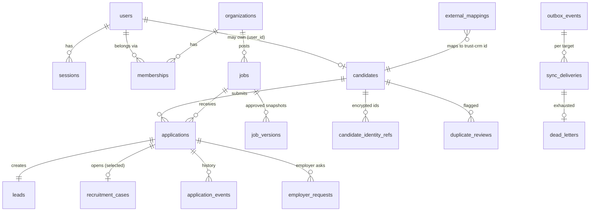

# Data model (Phase 1) and ownership

Schema: `src/db/migrations/*.sql` (forward-only, checksummed). UUID keys; UTC `timestamptz`; money never mixed across currencies (every amount carries its own).

## Entities in the product specification vs. Phase 1

| Spec entity | Table(s) | Phase |
|---|---|---|
| Users, Roles, Permissions | `users`, `sessions`, `otp_challenges`, code matrix (`permissions.js`) | 1 |
| Organizations, Memberships | `organizations`, `memberships`, `org_verification_submissions` | 1 |
| Candidates | `candidates`, `candidate_identity_refs`, `consents`, `data_requests`, `duplicate_reviews` | 1 |
| Leads | `leads` | 1 |
| Companies, Contacts | `organizations` (company); **contacts** as separate people records | company 1 / contacts 2 |
| Jobs | `jobs`, `job_versions`, `job_status_events`, `job_change_acks` | 1 |
| Applications | `applications`, `application_events`, `internal_notes`, `employer_requests` | 1 |
| RecruitmentCases | `recruitment_cases`, `case_events` | 1 |
| Notifications | `notifications` (in-app), `outbound_messages` (e-mail with honest states) | 1 |
| Integrations, ExternalMappings, WebhookEvents | `integration_connections`, `external_mappings`, `outbox_events`, `sync_deliveries`, `dead_letters`, `inbound_events`, `sync_conflicts`, `webhook_secrets`, `webhook_subscriptions` | 1 |
| AuditEvents | `audit_events` (append-only) | 1 |
| Settings/policies | `settings` | 1 |
| Documents, Media, Interviews, Conversations, Messages, Tasks, Agencies, Transactions, Commissions, AttendanceEvents, Projects, Proposals | — | 2–4 |
| Approvals (MCP), AutomationRuns | — | 3 |

## Ownership and attribution

* `introduced_by` (organizations, candidates) is **write-once** (DB trigger). `owner_user_id` is the current staff owner; every change is a row in the append-only `ownership_history` with who/why. `created_by` and `submitted_by_user` are never rewritten.
* Merging two people is a human decision recorded in `duplicate_reviews`; the surviving record keeps the account, applications, leads and identity references; the merged-away row stays with `merged_into` (no deletion).

## Database-enforced invariants

One live person per normalised email · one active application per candidate+job · one idempotency key per user · one pending employer request per type · identity number unique per kind (HMAC) · append-only audit/history tables · immutable `introduced_by` · enumerated statuses (CHECK) · salary currency/period coupled to "specified" (service + tests).

## Data classification and retention

| Class | Examples | Handling |
|---|---|---|
| Secret | password hashes, MFA secrets, webhook secrets, token hashes | hashed/encrypted; never returned; redacted in logs |
| Highly sensitive | passport/ID numbers, DOB | AES-GCM + HMAC; masked in API; staff scope only; never to employers |
| Personal | names, contact, profile | scoped by role/assignment; employer view minimised |
| Operational | jobs, stages | role-scoped |
Retention periods are **configuration, not hard-coded legal assumptions**; the deletion/export request workflow records requests (Phase 1) and executes them in Phase 2 once documents/media exist. Nothing is auto-deleted today.
